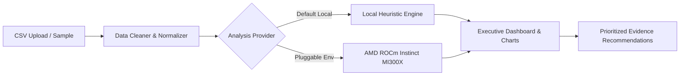

# Review2Action AI 🚀
### AMD Hackathon Prototype — E-Commerce Customer Review Intelligence & Recommendation Engine

> **Turn customer reviews into your next best action.**
> Review2Action AI takes messy, unstructured e-commerce product reviews, validates and cleans the data, determines multi-signal sentiment and topic distributions, and synthesizes evidence-backed business recommendations with assigned team ownership.

---

## 🌟 Key Highlights

- **Full-Stack Application**: Modern React + TypeScript + Vite frontend with Tailwind CSS and Recharts; robust Node.js + Express + TypeScript backend.
- **Strict Evidence Guarantee**: Never hallucinates conclusions. Every recommendation includes quantified metrics, root-cause explanations, and verbatim customer review quotes.
- **Zero API Key Requirement (Immediate Local Operation)**: Works out of the box with an intelligent, transparent rule-based sentiment lexicon and deterministic topic clustering engine.
- **Pluggable AMD Architecture**: Integrated with AMD Token Factory's hosted API (`Qwen3.8-Flash-Next`) for strategic reasoning and recommendations, with automated local heuristic failover.
- **In-Memory File Processing**: Ingested CSV files are processed entirely in server memory without persistent database storage. Server-side API keys are kept strictly protected.

---

## 🛠️ Technology Stack

| Layer | Technologies |
|---|---|
| **Frontend** | React 19, TypeScript, Vite, Tailwind CSS v4, Lucide React, Recharts |
| **Backend** | Node.js, Express, TypeScript, tsx, Multer, Papa Parse, Zod, express-rate-limit |
| **Analysis** | Local Heuristic Engine (Vader-style lexical polarity + star rating correlation) |
| **Inference Blueprint** | Pluggable AMD ROCm vLLM / TGI adapter (`AmdLlmAnalysisProvider`) |
| **Development** | Concurrently for synchronized full-stack hot reloading |

---

## 🚀 Quick Start Guide

### Prerequisites

- **Node.js**: v18.0.0 or higher (v24+ recommended)
- **npm**: v9.0.0 or higher

### Installation

From the project root:

```bash
# 1. Install root dependencies
npm install

# 2. Install server dependencies
cd server
npm install

# 3. Install client dependencies
cd ../client
npm install
```

### Running Locally

To launch both backend (port `5000`) and frontend (port `5173`) concurrently:

```bash
# From the root directory:
npm run dev
```

Visit **[http://localhost:5173](http://localhost:5173)** in your browser.

- **Frontend App**: `http://localhost:5173`
- **Backend API**: `http://localhost:5000`
- **API Health Check**: `http://localhost:5000/api/health`
- **Direct Sample Data API**: `http://localhost:5000/api/reviews/sample-data`
- **Download Sample CSV**: `http://localhost:5000/api/reviews/sample-csv`

---

## 📊 Core User Flow & Capabilities



1. **Dashboard & Landing**: Executive overview explaining the four-step pipeline (`Upload` → `Clean` → `Discover` → `Act`) with instant sample testing.
2. **CSV Upload & Ingestion**:
   - Drag-and-drop file uploader (supports up to 10 MB and 10,000 rows).
   - Ingestion summary reporting total uploaded rows, valid clean reviews, filtered empty rows, and eliminated duplicates.
   - Sample cleaned data preview table.
3. **Insights & Analytics Dashboard**:
   - KPI Cards: Total Valid Reviews, Positive/Neutral/Negative split, Average Rating (1–5 stars), and Primary Friction Topic.
   - Interactive Charts:
     - Sentiment distribution Donut chart
     - Top Issues & Topic frequency horizontal bar chart (color-coded for critical defect density)
     - Rating distribution bar chart
     - Sentiment trends over time line chart
   - Detailed Review Explorer table with real-time text search, sentiment pills, topic dropdowns, and pagination.
4. **Actionable Recommendations**:
   - 3 to 5 prioritized business recommendations (High, Medium, Low).
   - Clear action title, why it matters, and exact supporting metric (e.g. *"Shipping appeared in 31% of negative reviews"*).
   - Verbatim customer quotes safely truncated with quote indicators.
   - Suggested owner team (`Operations`, `Product`, `Customer Support`, `Marketing`, or `Quality Engineering`).
   - One-click **Export Report (Markdown)** button.
5. **About & Architecture**: Visual 4-step pipeline and complete AMD ROCm Instinct acceleration blueprint.

---

## 📋 Supported CSV Column Schema.

The CSV parser automatically cleans whitespace and normalizes headers using synonym detection:

| Canonical Column | Status | Accepted Synonyms | Purpose |
|---|---|---|---|
| `review_text` | **Required** | `review`, `text`, `comment`, `content`, `feedback`, `body`, `message` | Customer review text analyzed for sentiment and topics. |
| `rating` | *Optional* | `stars`, `score`, `rate`, `star_rating`, `review_rating` | Numeric rating (1–5). Coerced safely; non-numeric values become `null` without dropping the text. |
| `product_name` | *Optional* | `product`, `item`, `title`, `item_name`, `sku`, `model` | Enables grouping and filtering reviews by catalog product. |
| `review_date` | *Optional* | `date`, `created_at`, `timestamp`, `time`, `posted_at` | Enables sentiment-over-time trendline charts. Parses ISO and standard formats. |
| `review_title` | *Optional* | `headline`, `summary`, `subject`, `title` | Displayed as review headline and factored into keyword matching. |
| `review_id` | *Optional* | `id`, `uuid`, `row_id`, `index` | Unique review identifier (auto-generated if omitted). |

---

## 📦 SmartStock AI — Demand Forecasting & Replenishment Engine

SmartStock AI extends Review2Action AI as a second analytical module helping e-commerce teams plan inventory using historical sales, prices, stock levels, and dates.

### 🌟 Key Capabilities
- **Demand Forecasting**: Projects future product demand over 7, 14, or 30 days using trend-adjusted exponential smoothing and day-of-week seasonality.
- **Stockout Prevention**: Computes days until stockout and warns when runway falls below supplier lead times.
- **Replenishment Guidance**: Calculates scientific Reorder Points (ROP) and exact suggested order quantities to cover planning horizons plus safety buffer.
- **Zero Hallucination Evidence**: Fully transparent formulas with step-by-step mathematical traceability and honest handling of missing fields.

### 📋 SmartStock CSV Schema & Header Aliases

| Column | Status | Accepted Aliases | Description |
|---|---|---|---|
| `date` | **Required** | `timestamp`, `order_date`, `day`, `sales_date` | Date of recorded sales/inventory observation (YYYY-MM-DD or standard parseable dates). |
| `product_id` | **Required** | `product`, `sku`, `item_id`, `item`, `product_code` | Unique product identifier. |
| `units_sold` | **Required** | `sales`, `quantity_sold`, `units`, `quantity`, `qty` | Non-negative numeric units sold during observation period. |
| `product_name` | *Optional* | `name`, `product_title`, `title`, `description` | Human-readable product label. |
| `price` | *Optional* | `unit_price`, `selling_price`, `amount`, `cost` | Unit retail price in USD. |
| `inventory_level` | *Optional* | `stock`, `stock_level`, `inventory`, `on_hand` | Current physical on-hand stock. If omitted, stockout risk is honestly marked as "Unknown". |
| `lead_time_days` | *Optional* | `lead_time`, `supplier_lead_time`, `delivery_days` | Supplier replenishment transit time in calendar days. |
| `safety_stock` | *Optional* | `buffer_stock`, `minimum_stock`, `min_stock` | Buffer stock units to guard against demand spikes. |
| `promotion` | *Optional* | `promo`, `on_promotion`, `discount` | Boolean promotional flag (`true`/`false`). |

### 🧮 Forecasting Methodologies & Formulas

SmartStock AI selects the statistical model based on historical depth:

1. **Rich History (≥ 14 days)**:
   - **Model**: Holt's Linear Exponential Smoothing with Day-of-Week Seasonality Indexing.
   - **Seasonality**: 7-day cyclical ratio multipliers accounting for weekend/weekday consumer patterns.
   - **Backtesting**: Time-based holdout validation (last 7 days reserved) calculating **WAPE** (*Weighted Absolute Percentage Error*).
   - **Prediction Intervals**: Standard error of residuals scaled by $1.645 \times \sqrt{h}$ for ~90% prediction confidence bands.
2. **Moderate History (5 – 13 days)**:
   - **Model**: 7-day rolling moving average weighted toward recent sales velocity.
3. **Sparse History (< 5 days)**:
   - **Model**: Arithmetic mean baseline with visible sparsity and high-uncertainty warnings.

### 📐 Inventory Calculation Formulas

- **Average Daily Demand ($\bar{D}$)**:
  $$\bar{D} = \frac{\sum_{t=1}^{H} \hat{y}_t}{H}$$
  *(where $H$ is the chosen horizon: 7, 14, or 30 days)*
- **Days Until Stockout**:
  $$\text{Days to Stockout} = \frac{\text{Current Inventory}}{\bar{D}}$$
- **Reorder Point (ROP)**:
  $$\text{ROP} = (\bar{D} \times \text{Lead Time Days}) + \text{Safety Stock}$$
- **Suggested Replenishment Quantity**:
  $$\text{Suggested Reorder} = \max\left(0, (\text{Total Forecast Demand} + \text{Safety Stock}) - \text{Current Inventory}\right)$$
- **Stockout Risk Classification**:
  - **High**: Current inventory is 0 OR estimated days until stockout $\le$ supplier lead time.
  - **Medium**: Current inventory $\le$ Reorder Point OR stockout expected within planning horizon.
  - **Low**: Inventory runway safely exceeds planning horizon and lead time buffer.
  - **Unknown**: Inventory level or lead time was not provided in uploaded data.

### ⚠️ Assumptions & Limitations
- Assumes historical sales velocity patterns continue into the future without major unobserved macroeconomic shocks.
- Promotional spikes outside historical observations require manual promotional flag inputs.
- When `inventory_level` or `lead_time_days` is missing from the CSV, the system **never invents numbers** and displays clear explanations of which metrics cannot be computed.

---

## ⚡ Pluggable AMD ROCm™ LLM Integration Architecture

Review2Action AI and SmartStock AI are engineered with modular provider abstractions:

```typescript
// Review Sentiment & Recommendations Provider
export interface AnalysisProvider {
  readonly name: string;
  analyze(reviews: NormalizedReview[]): Promise<AnalysisOutput>;
}

// SmartStock Supply Chain Explanation Provider
export interface ExplanationProvider {
  readonly name: string;
  generateExplanation(context: ExplanationContext): Promise<string>;
}
```

### Explanation Providers Included

1. **`TemplateExplanationProvider` (Default Local Mode)**:
   - Operates 100% locally and offline without external network or API keys.
   - Generates deterministic, evidence-backed narrative summaries strictly referencing verified computed numbers.
2. **`LlmExplanationProvider` (AMD Token Factory Hosted API Adapter)**:
   - Connects to AMD Token Factory's hosted API endpoint serving `Qwen3.8-Flash-Next`.
   - Constrained to strict JSON schemas (`{"explanation": "..."}`) with strict system instructions prohibiting data fabrication.
   - Automatically falls back gracefully to `TemplateExplanationProvider` if offline or timeout occurs.

### Connecting Your AMD Token Factory Endpoint

To enable AMD Token Factory inference:

1. Open `server/.env` (or copy from `server/.env.example`).
2. Configure your AMD Token Factory credentials:

```bash
# Enable AMD LLM mode for both Review2Action and SmartStock AI
USE_AMD_LLM=true

# AMD Token Factory Hosted API Endpoint URL
AMD_LLM_ENDPOINT="https://api.tokenfactory.amd.com/v1"

# Target Model Hosted on AMD Token Factory
AMD_LLM_MODEL="Qwen3.8-Flash-Next"

# Server-Side API Bearer Token (Kept secure on backend, never sent to browser)
AMD_LLM_API_KEY="your_amd_token_factory_api_key_here"
```

3. Restart the backend (`npm run dev:server`).

---

## 🌐 API Reference

| Endpoint | Method | Module | Description |
|---|---|---|---|
| `/api/health` | `GET` | System | Health check reporting active modules and provider statuses. |
| `/api/reviews/analyze` | `POST` | Review2Action | Analyzes uploaded review CSV or raw text with rate limiting. |
| `/api/reviews/sample-data` | `GET` | Review2Action | Runs 1-click analysis on bundled sample review dataset. |
| `/api/reviews/sample-csv` | `GET` | Review2Action | Downloads realistic customer reviews sample CSV. |
| `/api/smartstock/forecast` | `POST` | SmartStock | Validates sales CSV and generates demand forecasts & inventory metrics. |
| `/api/smartstock/sample-data` | `GET` | SmartStock | Runs 1-click forecast on 92-day multi-product synthetic inventory dataset. |
| `/api/smartstock/sample-forecast` | `GET` | SmartStock | Alias for `/sample-data` computing forecast on sample dataset. |
| `/api/smartstock/sample-csv` | `GET` | SmartStock | Downloads representative 6-product sales & inventory sample CSV. |

---

## 🔒 Security & Reliability

- **File Validation**: Restricts uploads strictly to `.csv` files up to 10 MB and 15,000 rows.
- **Rate Limiting**: Protects `/api/reviews/analyze` and `/api/smartstock/forecast` with `express-rate-limit` (60 requests per 15 minutes per IP).
- **XSS & Content Sanitization**: React escapes rendered content; Papa Parse handles malformed commas, quotes, and newlines safely.
- **In-Memory Isolation**: Uploaded review and inventory data is processed in ephemeral memory and discarded automatically.

---

## 📄 License & Hackathon Notice

Developed for the **AMD Hackathon**. Designed for immediate local deployment and high-throughput AMD Instinct ROCm scaling.

